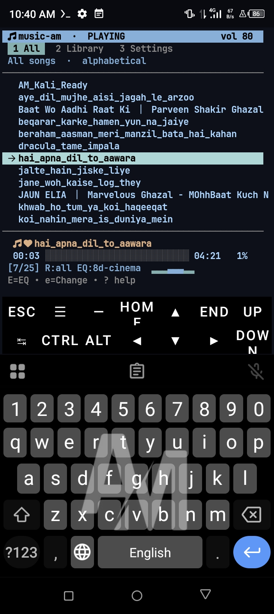
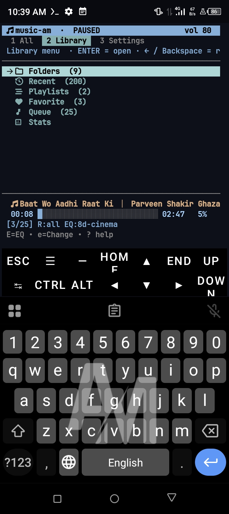
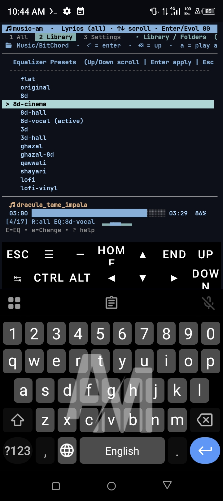
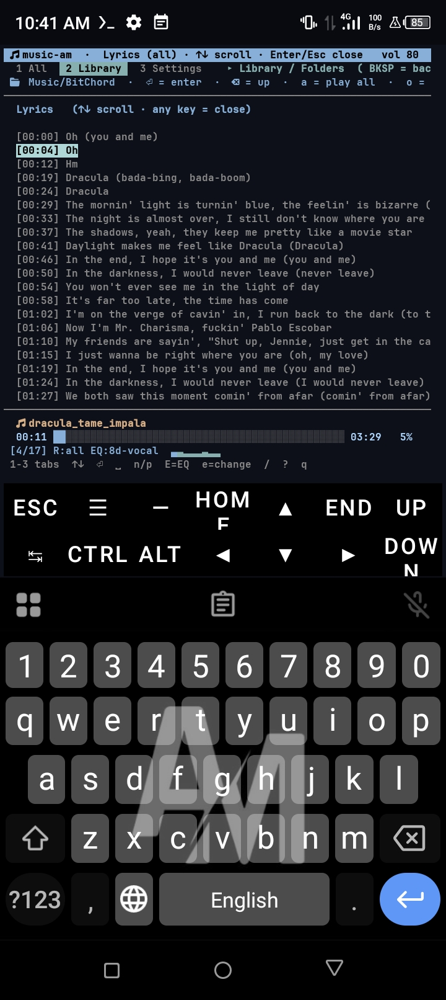
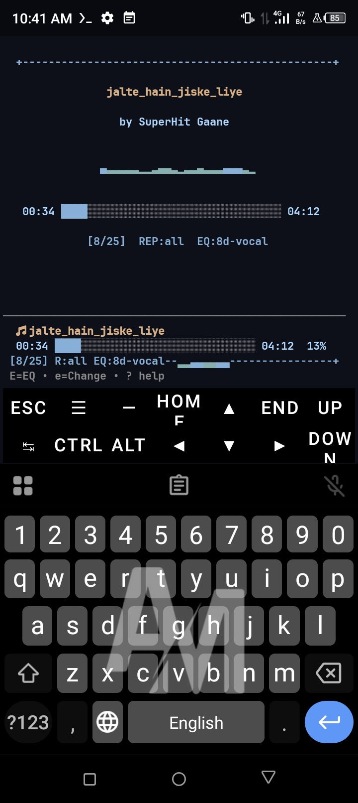
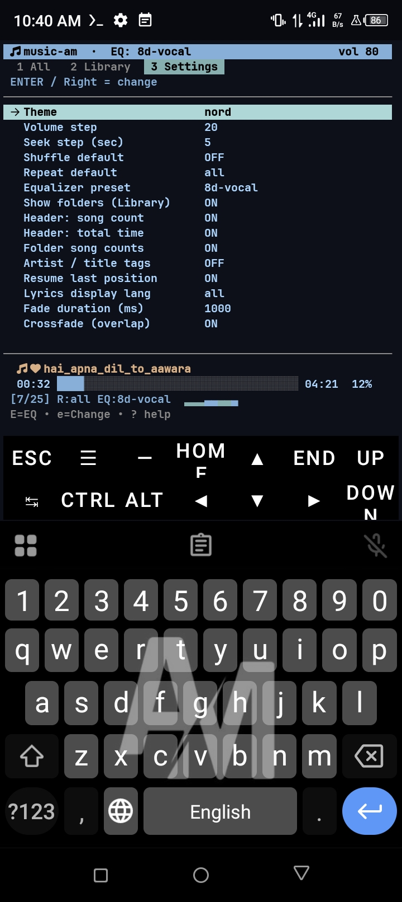
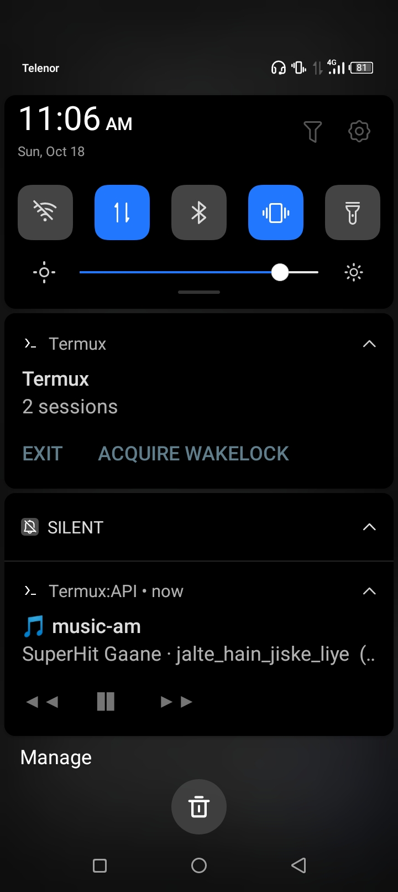

# music-am 🎵

A fast, keyboard-driven terminal music player for **Termux** (Android) and Linux, built with Python + curses + mpv.


## ✨ Features

### 🎧 Audio
- **16 equalizer presets** — 8D rotation, 3D spatial, Lo-fi, Bass, Vocal
- **Per-track EQ memory** — each song remembers its own EQ
- **Real crossfade** — 2 mpv instances
- **Custom fade duration** — 0-2000 ms
- **Sleep timer** with fade-out

### 📝 Lyrics
- **Auto-fetch from LRCLIB** — no manual `.lrc` files
- **Multi-language** — Hindi, Urdu, Roman, English
- **Display filter** — choose language in Settings
- **Synced scroll** — current line highlighted

### 🎨 UI
- **28+ themes** — Dracula Pro, Tokyo Night, Catppuccin, Monokai Pro
- **Bar visualizer** — 8 animated bars
- **Full-screen Now Playing**
- **Nerd Font TUI**

### 📚 Library
- **Folder navigation** — file-manager style
- **Smart playlists** — Recently Added, Most Played, Never Played, Same Artist, Same Album
- **Favorites, History, Queue**
- **Search filters** — `/artist:`, `/album:`, `/fav`, `/recent`, `/eq:`
- **Random song** (`y`)


## 📸 Screenshots

<div align="center">

### 🎵 Main Interface — All Songs


### 📁 Folder Navigation


### 🎛️ Equalizer Menu (16+ Presets)


### 📝 Synced Lyrics (Hindi/Urdu/Roman)


### 🎨 Full-Screen Now Playing


### ⚙️ Settings


### 📱 Android Notification Controls


</div>


### Folder Navigation


### 📊 Statistics
- Weekly / monthly plays
- Top 5 artists and tracks

## 📦 Installation

### Termux (Android)

```bash
pkg install python mpv termux-api
pip install python-mpv mutagen

git clone https://github.com/Musadddiqshah/music-am.git
cd music-am
python music-am.py
